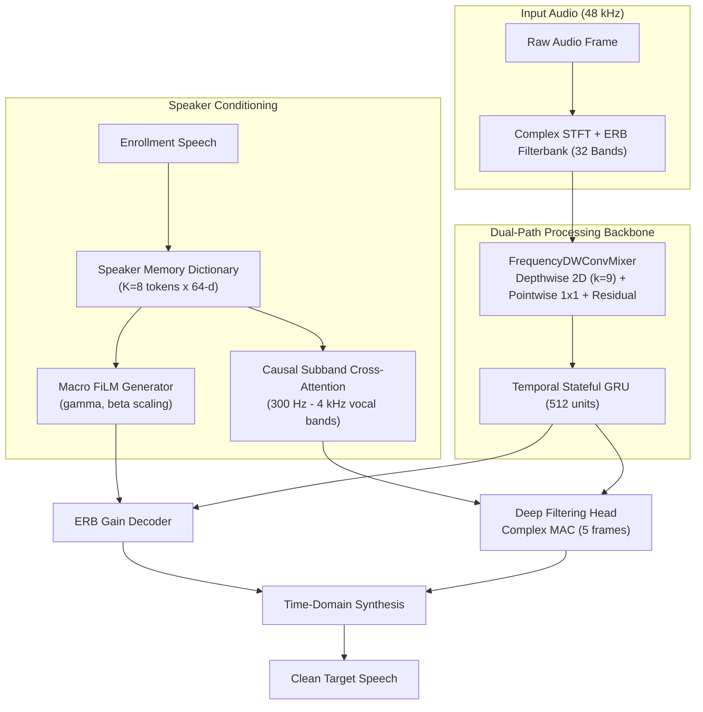

# ClearCore Train — pDFNet3 Pro Neural Training Suite

[](https://www.python.org/)
[](https://pytorch.org/)
[](https://onnx.ai/)
[](LICENSE)

**ClearCore Train (`cctrain`)** is the dedicated machine learning research and training repository for [ClearCore](https://github.com/joaorura/clearcore). It provides the full training loops, synthetic data augmentation, loss formulations, and reproducibility gates for:
1. **pDFNet3 Pro v2**: Dual-Path Causal Speech Enhancement and Target Speaker Extraction (TSE).
2. **Multi-Token Speaker Memory**: Scaled dot-product causal cross-attention with multi-token voice dictionary representations.
3. **Voice Profile Enrollment**: Acoustic feature extraction and speaker identity embedding models.

---

## Architecture Overview



### Key Architectural Inventions
- **Multi-Token Speaker Memory Dictionary**: Eliminates single-token cross-attention collapse by projecting enrollment vectors into $K=8$ discrete phonetic tokens ($\mathbb{R}^{B \times 8 \times 64}$), evaluated frame-by-frame via scaled dot-product attention with cosine spectral roll-off edges.
- **Frequency Depthwise-Conv Mixer**: Enhances inter-band spectral context across the 32 ERB bands prior to temporal recurrent processing.
- **Advanced Loss Formulation**:
  - $\mathcal{L}_{\text{abs}}$ (*Target-Absence Loss*): Strict energy zeroing during pauses or absence of the target speaker.
  - $\mathcal{L}_{\text{conf}}$ (*Interferer Rejection InfoNCE*): Explicit speaker contrastive penalty pushing away secondary background voices.
  - $\mathcal{L}_{\text{DF-reg}}$ (*Deep Filter Temporal Regularization*): $L_1$ first-order temporal smoothing over complex filter coefficients, preventing metallic and phase artifacts.
  - *Asymmetric Formant Loss*: Psychoacoustic frequency weighting (300 Hz – 3,4 kHz) preventing over-suppression of human voice fundamentals.

---

## Objective Benchmarks (Holding-Out Test Sets)

Evaluated on isolated holding-out microphones (seed 42):

| Acoustic Condition | Metric | Baseline (DFNet3) | pDFNet3 Pro v2 | Gain |
| :--- | :--- | :---: | :---: | :---: |
| **Analog Headset Mic (Background Voices)** | Silence Attenuation<br>Silenced Pauses (% ZERO)<br>$\Delta$SI-SDR (0 dB Mix) | 18.83 dB<br>54.8%<br>+5.85 dB | **20.03 dB**<br>**67.8%**<br>**+5.93 dB** | **+1.20 dB**<br>**+13.0%**<br>**+0.08 dB** |
| **Bluetooth Mic (HFP / Leakage)** | Silence Attenuation<br>Silenced Pauses (% ZERO)<br>$\Delta$SI-SDR (0 dB Mix)<br>$\Delta$STOI (0 dB Mix) | 21.43 dB<br>80.6%<br>+4.18 dB<br>+0.021 | **23.43 dB**<br>**88.2%**<br>**+4.57 dB**<br>**+0.034** | **+2.00 dB**<br>**+7.6%**<br>**+0.39 dB**<br>**+0.013** |
| **Laptop Built-in Mic (Chassis / Fan Noise)** | Silence Attenuation<br>Silenced Pauses (% ZERO)<br>$\Delta$SI-SDR (0 dB Mix) | 17.72 dB<br>58.3%<br>+5.94 dB | **18.71 dB**<br>**67.7%**<br>**+5.93 dB** | **+0.99 dB**<br>**+9.4%**<br>-0.01 dB |
| **Environmental Room Noise** | Silence Attenuation<br>Silenced Pauses (% ZERO)<br>$\Delta$SI-SDR (0 dB Mix) | 21.63 dB<br>63.2%<br>+6.02 dB | **22.62 dB**<br>**72.9%**<br>**+6.30 dB** | **+0.99 dB**<br>**+9.7%**<br>**+0.28 dB** |

---

## Getting Started

### Prerequisites
- Python `3.11.*`
- CUDA 12.8+ (for GPU acceleration on NVIDIA RTX / Blackwell / Ada Lovelace)
- [uv](https://github.com/astral-sh/uv) (recommended package manager)

### Installation
```bash
git clone https://github.com/joaorura/clearcore-train.git
cd clearcore-train
uv sync
```

### Running Tests
```bash
PYTHONPATH=src uv run pytest tests/
```

### Training
To train the pDFNet3 Pro model:
```bash
PYTHONPATH=src uv run python scripts/train_pro.py \
  --batch-size 16 \
  --epochs 10 \
  --device cuda
```

### Exporting Reproducible Release Assets (ONNX & Stateful Models)
```bash
PYTHONPATH=src uv run python scripts/m3_export.py \
  --ckpt runs/m2/pro-v2-dualpath-tse-20261008/checkpoints/ckpt-00075000.pt \
  --out-dir runs/m3_export
```

---

## Repository Structure

```
clearcore-train/
├── configs/          # Dataset split configurations and trial manifests
├── docs/             # Technical specifications, milestone reports, and handoffs
├── manifests/        # Audio corpus file and speaker manifests (VCTK, LibriSpeech, CML-TTS)
├── scripts/          # Training entrypoints, eval benchmarks, dataset synthesizers
├── src/cctrain/      # Core package
│   ├── data/         # Audio dataset loaders, RIR convolvers, enrollment augmenters
│   ├── eval/         # Real-time hop parities, STOI / SI-SDR metric calculators
│   ├── export/       # ONNX graph packagers and bit-exact reproducibility checkers
│   ├── losses/       # Multi-resolution STFT, asymmetric formant, InfoNCE losses
│   └── models/       # pDFNet3 Pro, Dual-Path mixer, Speaker Memory, FiLM generators
└── tests/            # Test suite (cross-attention, latency budgets, causal masks)
```

---

## License

This software and training pipeline are licensed under the **PolyForm Noncommercial License 1.0.0** ([LICENSE](LICENSE)).
For production deployment binaries and user applications, visit [ClearCore](https://github.com/joaorura/clearcore).
